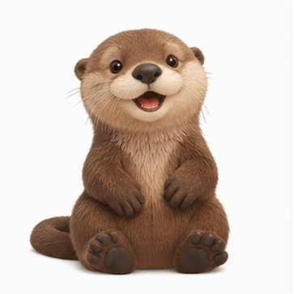

# 原创动作 GIF 工作坊

一个给 AI 助手使用的原创动作 GIF 制作 skill，附离线 audit 工具。助手可按授权调用自己已有、确实支持所需能力的生成工具，带你从角色锚点做到小批动作；附带的 Python CLI 只做文件核验，不直接生成图片或发送 API 请求。



**ChatGPT 功能实测，具体 model 未知。** 上方直接引用真实多帧 GIF，不是静态封面。它是使用者提供的既有样例，不代表本轮完成 2.6 模型验证或微信投稿。

**当前版本是制作工作流与离线检查工具，不是微信投稿包。** 没有已核实的官方平台规范 profile，所有报告都保留 `submission_ready=false`。

## 直接这样说

> 用这个 skill，拿我提供的原创角色先做 1 张挥手 GIF，预算确认后再扩成一套；记录模型和文件检查结果。

把 `SKILL.md` 交给助手使用即可，不需要记住命令。助手先确认角色、可用生成入口及成本授权；首张若涉及收费，也先确认预算。已有工具无法输出原生 GIF 时会说明缺口，而不是拿静态图摇摆交差。下面的命令是给需要自己检查文件的人准备的。

## 立即试用

需要 Python 3.10+ 和已有的 Pillow。此次验证环境为 Python 3.14.3 / Pillow 12.1.1；未安装任何依赖。可先检查自己的环境：

```sh
python3 -B -c "import PIL; print(PIL.__version__)"
python3 -B scripts/audit_gif.py audit examples/otter-wave-gif-test.gif --out output/otter-01
python3 -B -m unittest discover -s tests -v
```

在仓库根目录运行。输出目录必须不存在；重新检查请换成 `output/otter-02`，程序不会覆盖旧报告或源文件。缺少 Pillow 时先由使用者决定依赖管理方案，skill 不会自行安装。

每次检查输出：

| 文件 | 用途 |
| --- | --- |
| `audit.json` | 实际格式、签名、尺寸、体积、帧数、distinct 帧、每帧时长、loop、SHA256 和状态 |
| `contact-sheet.png` | 所有解码帧的联系图，附索引及编码时长 |
| `frames/frame-000.png` 等 | 按 GIF disposal/偏移合成后的完整画面，供原尺寸核验 |
| `preview.html` | 自包含离线页面：原 GIF 字节播放、解码帧播放/暂停、前后帧和滑块 |

有权限时可直接打开 `preview.html`，无需服务器或网络。原 GIF 播放与逐帧回放是两个独立视图；后者始终循环以便检查，不代表源文件 loop。浏览器可能调整极短帧延迟，以 JSON 的编码时长为准。

退出码：`0` 技术通过，`1` 文件技术失败，`2` 命令、输入或输出问题。单帧 GIF、伪装成 `.gif` 的 PNG、所有解码帧都相同、损坏文件或非正帧时长均失败。不存在输入时仍尝试写失败报告；输出目录冲突时不写任何报告。

## 已有示例

示例是用户提供并授权复制的既有 ChatGPT 真 GIF，不是本仓库新生成的作品。生成界面没有显示模型 ID，因此 **不能据此声称已验证 GPT Image 2.6**。它也不是下方 8 个规划动作的生成结果，不是微信成品。

本地重新解码结果：363 × 363、12 帧、12 个 distinct 帧、每帧 200 ms、总时长 2400 ms、523723 字节、无限循环。准确 SHA256 和完整证据见 [示例 QA](examples/qa/audit.json) 与 [来源说明](examples/provenance.json)。

## 从角色到动作

1. 定一份角色锚点：脸型、比例、配件位置及不可改变的细节。
2. 只试 1–2 个动作。描述身体如何准备、执行、回到起点，不只写“开心”“动起来”。
3. 经授权后，使用支持原生 GIF 的工具或手工界面生成并下载原文件。
4. 运行 audit，再逐帧和播放审查；自动结果不会替你批准动作。
5. 试样获得接受后再扩批。补齐当前官方平台要求之前，只交付素材试样和报告。

[手工教程](references/workflow.md) 包含可直接使用的提示词和审查步骤。[动作 manifest](manifests/otter-actions.planning.json) 有 8 个原创海獭小动作，状态全部为 `planned_not_generated`，没有隐含生成任务。

## GPT Image 2.6 的边界

OpenAI 于 2026-11-04 公布 Images 2.6；公开文档与账户实际可用能力需要分开看。[官方发布说明](https://openai.com/index/introducing-images-2-6/)

截至 2026-11-06，官方列有 `gpt-image-2.6-flare` / `gpt-image-2.6-sunburst`；GIF 请求使用 `output_format=gif`、`frame_count=2..16`，并要求所选模型的 GIF preview 权限。[API Reference](https://developers.openai.com/api/reference/resources/images/methods/generate)

本仓库只提供 [不执行的参数样例](examples/api-request.plan.json)。没有 API 客户端、密钥读取、重试、隐含账单或自动生成。原生工具调用规则优先；不要把 REST 参数强塞进一个不支持它们的工具。进一步说明见 [官方能力记录](references/openai-gif.md)。

## 验证状态

| 项目 | 状态 |
| --- | --- |
| Python CLI / 几何夹具 unittest | 已实际运行；详见 [验证记录](VALIDATION.md) |
| 自有示例格式与逐帧解码 | 已核验，原始文件未改动 |
| HTML 文件和内嵌原始 GIF | 已产出；自动检查字节一致性，浏览器播放尚未人工验收 |
| 原生动作质量、角色一致性 | 人工审查与用户接受仍单独记录 |
| GPT Image 2.6 实际生成 / API preview 权限 | 本轮未调用、未验证 |
| 微信 profile / 上传 / 审核 | 未验证、未执行 |
| 源码与许可 | BNB-LG 维护，原创代码与文档为 MIT；示例权利说明单独记录 |

## 工具不证明什么

- distinct 是合成后 RGBA 画面的精确哈希计数，忽略完全透明像素的隐藏颜色；它不是“有意义动作”的评分。平移、噪声变化也可能产生不同帧。
- GIF 的实际格式以签名和 Pillow 解码为准，而非后缀。它不能证明 AI 来源或具体模型。
- 缺少 loop 扩展会记录为 `unspecified`，不会当作无限循环；有限 loop 保留原始数值，不推断各播放器的重复次数。
- 联系图用灰色底辅助查看，不是对透明背景生成能力或平台透明规范的认证。
- 文件上限 32 MiB、最多 256 解码帧、单帧 400 万像素、累计 3200 万像素是本工具的资源保护线，不是微信要求。超过限制会失败；未完整解码的帧数/时长只是已检查部分。超大输入不读全文，SHA256 会保留 `null`。
- profile 当前只有待补齐清单，没有可执行的平台规则。MVP 不接受 `--profile`，也不输出“合规通过”。

## 结构与许可

`SKILL.md` 是 skill 入口；`scripts/` 是独立实现的离线工具；`tests/` 只生成合成几何测试夹具，不把测试图当成品。

原创代码和文档使用 [MIT](LICENSE)，版权署名 BNB-LG。示例来源与权利范围单独列在 [provenance.json](examples/provenance.json)。参考仓库的许可核验和复用边界见 [ACKNOWLEDGEMENTS](ACKNOWLEDGEMENTS.md)，外部依赖见 [依赖许可清单](DEPENDENCIES.md)。公开版本不含个人绝对路径、聊天链接或密钥。
